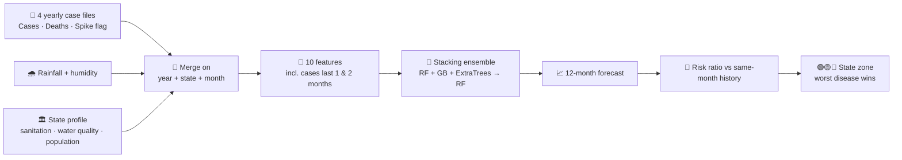

# Smart Water-Borne Disease Alert Dashboard

An ML-powered early-warning dashboard for water-borne disease risk across North-East India — case + death history, a red/yellow/green risk map, live weather, live news, a hospital locator, email alerts, and an optional AI helper bot.

**Live Link:** https://ne-monsoonai-app.streamlit.app/  

<div align="center">

A stacked ML ensemble forecasts next-month cases for **5 diseases × 8 states**, turns them into a **Green / Yellow / Red risk map**, and adds live weather, live news, a hospital locator, email alerts and an optional AI helper.

[](https://ne-monsoonai-app.streamlit.app/)
&nbsp;


**[🚀 Open the live app](https://ne-monsoonai-app.streamlit.app/)** · [Features](#-features) · [The model](#-the-model) · [Evaluation](#-evaluation-honest-numbers) · [Run locally](#-run-locally)

<br>


</div>

> ⚠️ **All disease, rainfall and hospital data are synthetic.** They are generated with realistic seasonal patterns and case-fatality ratios for a portfolio demo, not taken from government surveillance. Hospital contacts are placeholders (`@demohospitals.example`) and reach nobody.

---

## 📊 At a glance

| | | | |
|:--:|:--:|:--:|:--:|
| **8** NE states | **5** diseases | **4** years (2022-25) | **1,920** monthly records |
| **452,754** cases | **2,509** deaths | **133** outbreak spikes (6.9%) | **65** demo hospitals |
| **3** stacked models | **10** features | **11** dashboard pages | **3** live data feeds |

---

## Features

<table>
<tr>
<td width="50%" valign="top">

### Risk Zone Map
Each state gets a **Green / Yellow / Red** zone. The map shows *which disease* drives it, with predicted cases and deaths.

</td>
<td width="50%" valign="top">

### Disease Prediction
Pick a state and disease, get a **12-month forecast** of cases and expected deaths, plus a plain-language advice line.

</td>
</tr>
<tr>
<td valign="top">

### Live Weather & Live News
Current weather from **Open-Meteo** (cached 30 min) and local health news from **Google News RSS** (cached 1 h).

</td>
<td valign="top">

### Hospital Locator
Search by state or place (geocoded), ranked by **haversine distance**, showing beds, doctors and medicine / ORS stock.

</td>
</tr>
<tr>
<td valign="top">

### Email Alerts
Send alert emails over Gmail SMTP using your own App Password, stored locally in `.env` (git-ignored).

</td>
<td valign="top">

### 🤖 HelperBot
Optional **Groq-powered** chat for water-safety questions. Everything else works without any key.

</td>
</tr>
</table>

<details>
<summary><b>📄 All 11 pages (click to expand)</b></summary>

Overview · Disease Prediction · Risk Zone Map · Live Weather · Live News · Hospital Locator · HelperBot (AI) · Alerts & Notifications · Do's & Don'ts · Documentation · About

</details>

---

## 🧠 The model



| Part | Detail |
|---|---|
| **Algorithm** | `StackingRegressor`: RandomForest + GradientBoosting + ExtraTrees (200 trees each), final estimator RandomForest |
| **Features (10)** | month, state, disease, cases last month, cases 2 months ago, rainfall, humidity, sanitation index, water-quality index, population |
| **Target** | monthly cases per state and disease |
| **Deaths** | predicted cases × the empirical per-disease case-fatality ratio |

### How a zone is decided

`risk ratio = predicted next-month cases ÷ that state-disease's historical average for the same calendar month`

| Zone | Ratio |
|:--:|:--:|
| 🟢 Green | < 1.10× |
| 🟡 Yellow | 1.10× – 1.39× |
| 🔴 Red | ≥ 1.40× |

Comparing against the **same calendar month** (not a flat yearly average) removes the monsoon seasonality, so a normal July is not flagged just for being July. A state's zone is its **riskiest disease**.

---

## 📏 Evaluation (honest numbers)

Measured by re-running the exact model from `app.py` on the included data:

| Split | R² | MAE (cases) |
|---|:--:|:--:|
| Random 80/20 (what the app reports) | **0.61** | **105.6** |
| **Time-based**: train 2022-24, test 2025 | 0.45 | 116.6 |
| Naive baseline: "same as last month" (2025) | 0.45 | n/a |

<details>
<summary><b>🔍 What this tells us</b></summary>

- The app's headline R² (~0.6) is **intentionally modest**: ~7% of months get a random outbreak spike (2.2-4.5× cases), so the data has real irregularity.
- On a stricter **time-based** split, the ensemble roughly **ties the "same as last month" baseline**, so most of its skill is persistence. That is expected on synthetic data, where outbreak spikes are random and cannot be predicted.
- A random split lets the model see neighbouring months of the same series, so it flatters the score. Time-based validation is the right protocol for real surveillance data.

</details>

---

## Synthetic data pipeline

`generate_datasets.py` (seeded, so reproducible) builds every file in `data/`:

| File | Rows | Contents |
|---|:--:|---|
| `NE_WaterBorne_2022…2025_Synthetic.xlsx` | 480 each | Cases, Deaths, Outbreak_Spike per state × disease × month |
| `NE_RainfallHumidity.xlsx` | 384 | Monthly rainfall (mm) and humidity (%), 8 states × 4 years |
| `NE_StateProfile.xlsx` | 8 | Capital, coordinates, population, sanitation, water quality, literacy |
| `NE_Hospitals.xlsx` | 65 | Beds, doctors, medicine stock, ORS/IV, contacts (placeholders) |

Cases follow `Poisson(base × population × weather pressure × sanitation gap)`, with a 7% chance of a 2.2-4.5× outbreak spike. Deaths come from a per-disease case-fatality range.

---

To regenerate the data: `python generate_datasets.py`

<details>
<summary><b>🔐 Optional: email alerts and HelperBot</b></summary>

- **Email:** needs a Gmail **App Password** (2-Step Verification on), entered on the Alerts page.
- **HelperBot:** free key from [console.groq.com/keys](https://console.groq.com/keys). The model name is the `GROQ_MODEL` constant in `app.py`; if Groq retires it, pick a current one from their docs.
- Secrets are saved to a local `.env`, which `.gitignore` excludes. Never commit or paste it.

</details>

---

## ⚠️ Limitations

- **Synthetic data only.** Not for real public-health decisions.
- Stacking ensemble adds little over a persistence baseline on a time-based split.
- Thresholds (1.10× / 1.40×) and case-fatality ranges are illustrative.
- Hospital "message" actions go to placeholder addresses.

## 🗺️ Roadmap

- [ ] Time-based cross-validation as the reported metric
- [ ] Prediction intervals for the forecasts
- [ ] Plug in real IDSP / state surveillance data
- [ ] Verified real hospital directory

---

## Files you need (all included)

```
health_dashboard/
├── app.py                      # the dashboard
├── generate_datasets.py        # regenerates the synthetic data below
├── requirements.txt
├── .gitignore                  # keeps .env out of git — important, see below
└── data/
    ├── NE_WaterBorne_2022_Synthetic.xlsx
    ├── NE_WaterBorne_2023_Synthetic.xlsx
    ├── NE_WaterBorne_2024_Synthetic.xlsx
    ├── NE_WaterBorne_2025_Synthetic.xlsx   ← Cases + Deaths + Outbreak_Spike columns
    ├── NE_RainfallHumidity.xlsx
    ├── NE_StateProfile.xlsx
    └── NE_Hospitals.xlsx                   ← ⚠️ synthetic placeholder data, see below
```

## Running it

```bash
pip install -r requirements.txt
streamlit run app.py
```

<div align="center">

Built by **[Krishna Lal](https://krbtech.xyz)** · [GitHub](https://github.com/Krish033-source)

</div>
